# DKLab Platform: nền tảng quản lý đa ngành

Một source code chạy cho nhiều khách hàng (multi-tenant), chia theo plugin cho từng ngành: **du lịch** (đã có), cà phê, nhà hàng, khách sạn, spa, kế toán (cùng khuôn module).
Mỗi khách hàng có domain riêng, phân quyền riêng, website đặt chỗ và trang quản trị riêng.

> 6 doanh nghiệp demo (mỗi ngành một): `dulich_demo`, `spa_demo`, `cafe_demo`, `nhahang_demo`, `khachsan_demo`, `ketoan_demo`.
> Super Admin quản trị tất cả tại **`/superdklab`** (mặc định `dklab` / `Dklab@123`, **đổi ngay sau khi đăng nhập**).

| Trang chủ (3D, animation) | Hướng dẫn từng bước | Gợi ý trường bắt buộc | Mobile |
|---|---|---|---|
| 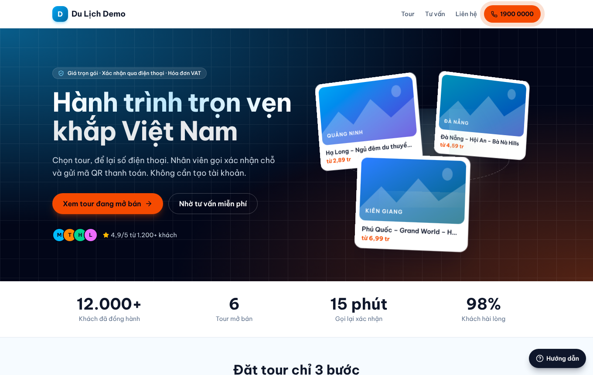 | 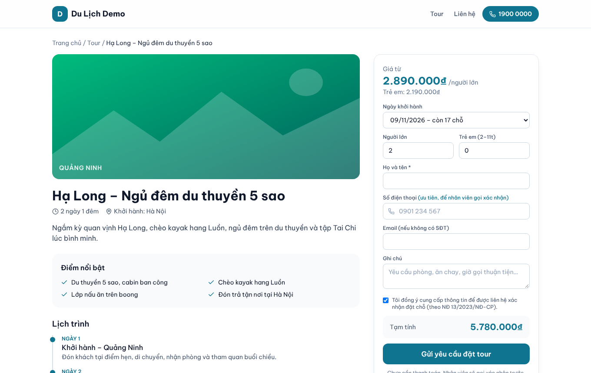 | 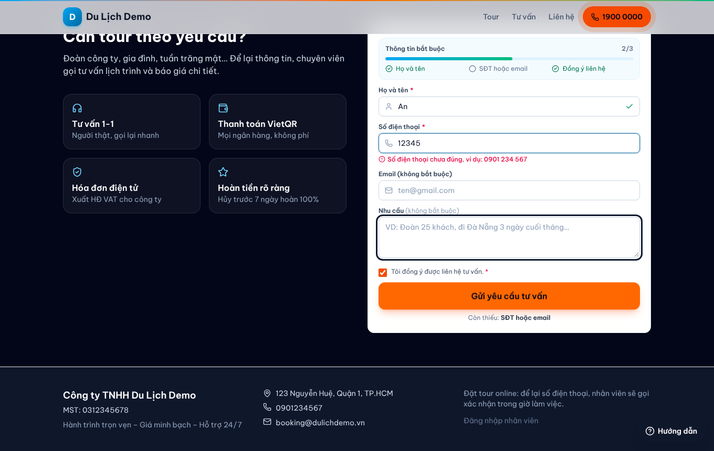 | 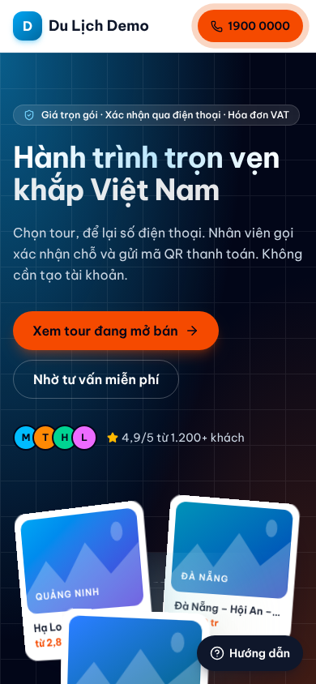 |

| Lễ tân tiếp nhận | Hóa đơn + VietQR + MISA | Phân quyền |
|---|---|---|
| 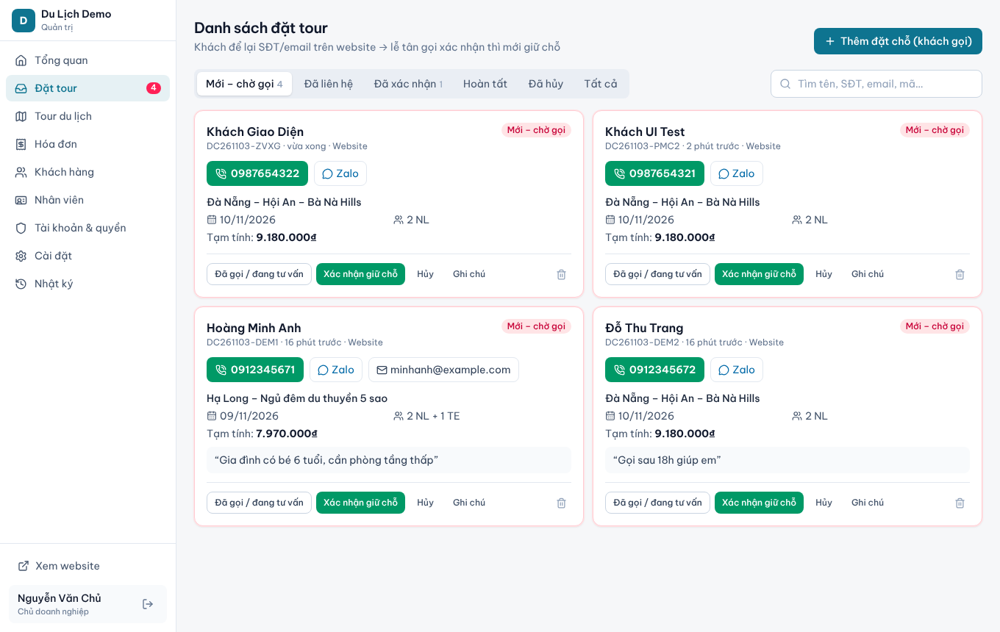 | 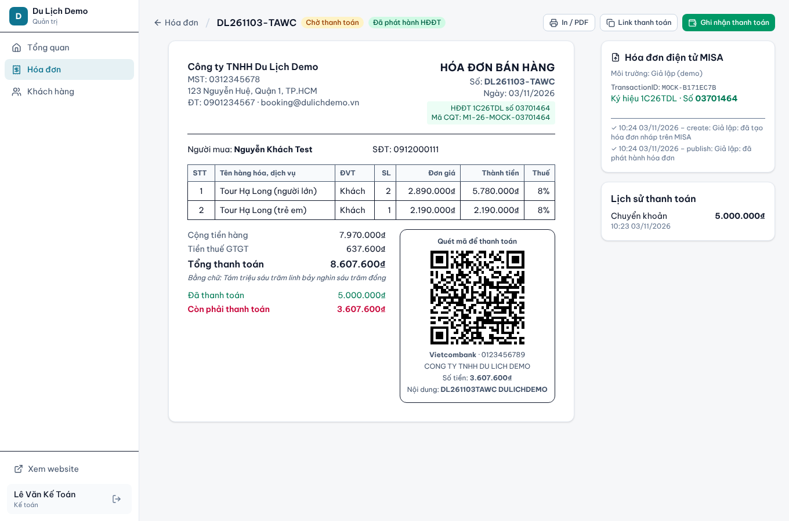 | 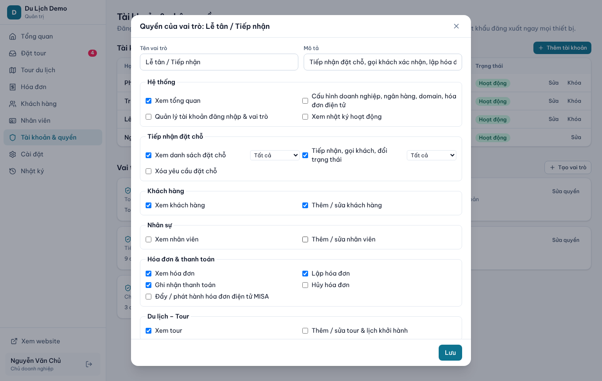 |

## Công nghệ

| Lớp | Lựa chọn | Lý do |
|---|---|---|
| Framework | **Next.js 16.4** (App Router, Cache Components, `proxy.ts`), React 19.3 | Một app gồm cả website, admin và API |
| State client | **Redux Toolkit 2 + RTK Query + redux-persist** | Mỗi dữ liệu chỉ tải 1 lần; F5 hiện ngay từ cache rồi làm mới ngầm |
| UI | Tailwind CSS v4, lucide-react, font Be Vietnam Pro | Nhẹ, đổi màu thương hiệu theo tenant bằng CSS variable |
| DB | PostgreSQL + **Drizzle ORM** (postgres.js) | Nhẹ, SQL rõ ràng, chạy tốt với Neon trên Vercel |
| Auth | **JWT tự xây bằng `jose`** + argon2id (`@node-rs/argon2`) | Kiểm soát claims, tenant và xoay vòng refresh token |
| Validate | Zod 4 | Thông báo lỗi tiếng Việt |
| Thanh toán | **VietQR (EMVCo/NAPAS)** tự sinh + `qrcode` | Mọi app ngân hàng quét được, không phí, không phụ thuộc bên thứ ba |
| HĐĐT | **MISA meInvoice** adapter (mock / test / live) | Đẩy hóa đơn, phát hành, lưu số HĐ |

## Kiến trúc

```
Host (dulichabc.vn / dulich-demo.dklab.vn / *.vercel.app)
        │
   src/proxy.ts ── xác định tenant theo domain ── rewrite /  →  /s/<tenant>/…
        │                                     └── chặn /admin khi chưa đăng nhập
        ├── /s/[tenant]/…        Website public (Server Components + 'use cache', tag theo tenant)
        ├── /pay/[token]         Trang thanh toán hóa đơn của khách (VietQR)
        ├── /admin/…             Quản trị (Client + Redux/RTK Query, cache localStorage)
        └── /api/auth/*, /api/v1/*, /api/public/*   REST API dùng chung web / mobile / POS
```

```
src/
  modules/registry.ts   ← Plugin: mỗi module khai báo quyền + menu
  modules/presets.ts    ← Preset ngành (module bật sẵn) + vai trò mặc định
  lib/auth/             ← JWT, phiên, mật khẩu
  lib/api.ts            ← withAuth(permission, handler): xác thực + phân quyền + phạm vi
  lib/payments/vietqr.ts← Sinh VietQR (CRC16, TLV EMVCo)
  lib/einvoice/misa.ts  ← Adapter MISA meInvoice
  lib/db/schema.ts      ← Lược đồ (mọi bảng có tenant_id)
  store/                ← Redux store, RTK Query API, persist
  app/                  ← Trang + API route
```

## Ngành nghề (plugin) & động cơ dùng chung

| Ngành | Động cơ | Khách làm được gì | Admin có gì |
|---|---|---|---|
| Du lịch | `tours` | Xem tour, lịch khởi hành, chỗ trống, đặt tour | Tour, lịch khởi hành, số chỗ |
| Spa – Làm đẹp | `slots` | Chọn dịch vụ → ngày → **giờ còn trống** → KTV (tùy chọn) | Dịch vụ (thời lượng), KTV & giường, Lịch timeline |
| Quán cà phê | `tables` | Xem menu, chọn giờ đến, **chọn bàn trống trên sơ đồ** | Menu, **sơ đồ bàn kéo thả + trạng thái trực tiếp**, xếp khách vãng lai, Lịch |
| Nhà hàng | `tables` + đặt món trước | Như cà phê + **chọn món trước** | Như cà phê; món đặt trước tự thành dòng hóa đơn |
| Khách sạn – Homestay | `rooms` | Chọn ngày nhận/trả → **loại phòng còn trống**, tổng tiền theo đêm | Loại phòng, sơ đồ phòng (có khách / sắp nhận / cần dọn), check-in/out, Lịch 14 ngày |
| Dịch vụ kế toán | `slots` + module `accounting` | Xem gói, đặt lịch tư vấn với chuyên viên | **Hợp đồng**, **lịch kê khai thuế** (tháng/quý/năm, nhắc quá hạn), **lập hóa đơn phí tháng hàng loạt** |

**3 động cơ dùng chung** (mọi ngành mới chỉ là cấu hình lại):
- **Danh mục** (`catalog_categories`, `catalog_items`): món / dịch vụ có thời lượng / loại phòng / gói.
- **Tài nguyên** (`resources`): bàn (vị trí x/y trên sơ đồ), phòng, giường, nhân viên.
- **Giữ chỗ** (`reservations`): khoảng thời gian trên từng tài nguyên. **Chống đặt trùng ở tầng database** bằng `EXCLUDE USING gist (resource_id WITH =, tstzrange(start,end) WITH &&)`.
  - Đã test 6 request đồng thời tranh 1 bàn: đúng 1 thành công.
  - Khách gửi yêu cầu thì chỗ được giữ tạm (`pending`). Lễ tân xác nhận, hủy hoặc báo không đến thì trạng thái đồng bộ theo.

| Spa: đặt lịch | Cà phê: chọn bàn trên sơ đồ | Khách sạn: phòng trống |
|---|---|---|
| 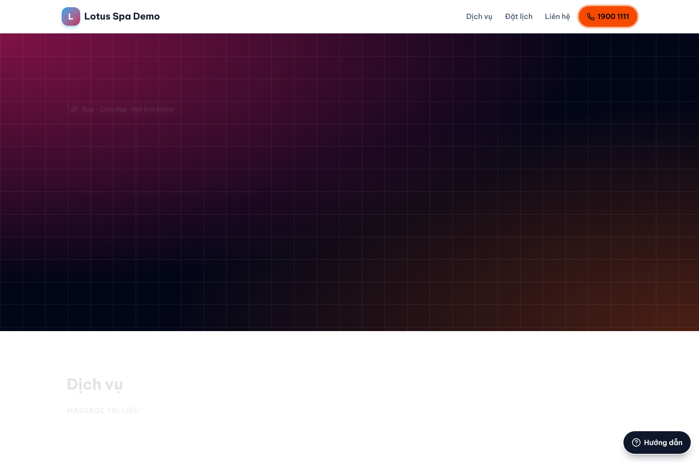 | 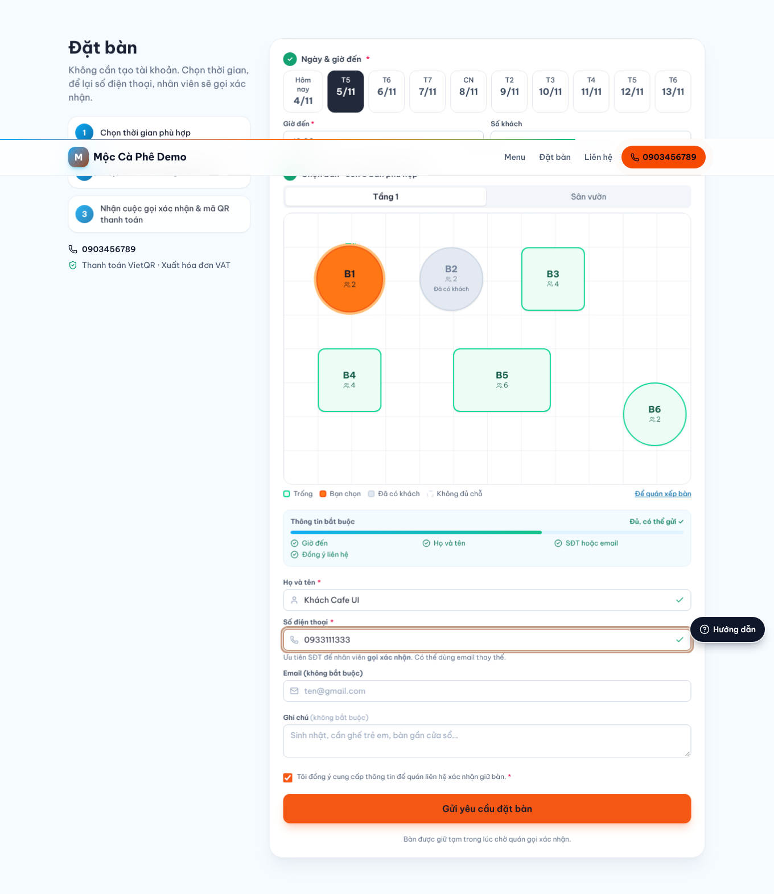 | 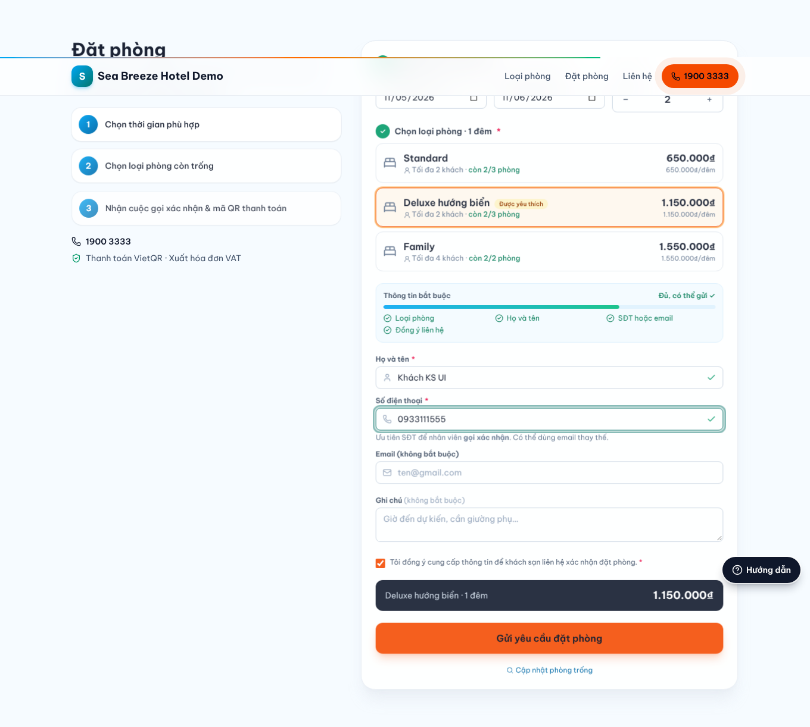 |

| Admin: sơ đồ bàn | Admin: lịch timeline | Kế toán: lịch thuế | Super Admin |
|---|---|---|---|
| 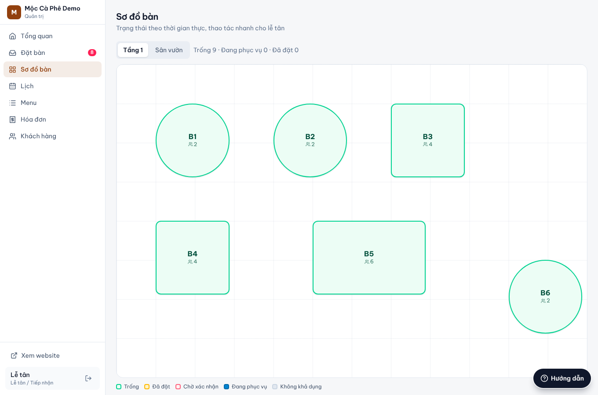 | 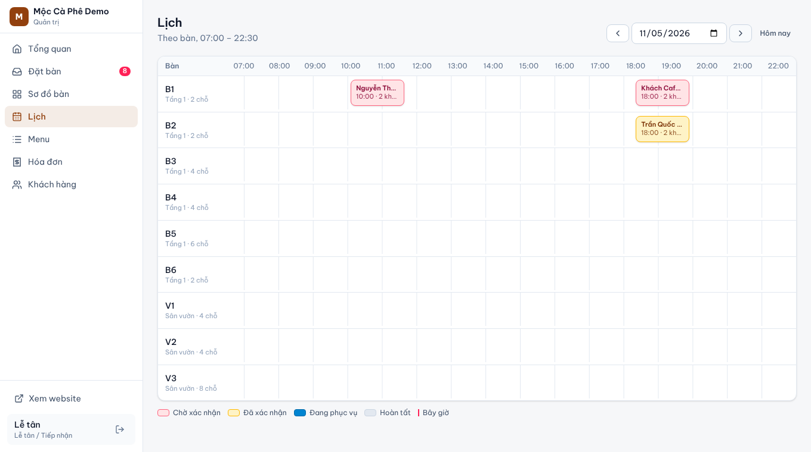 | 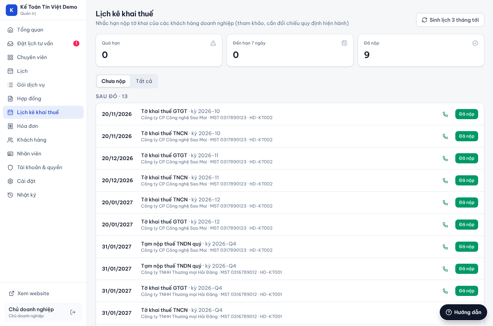 | 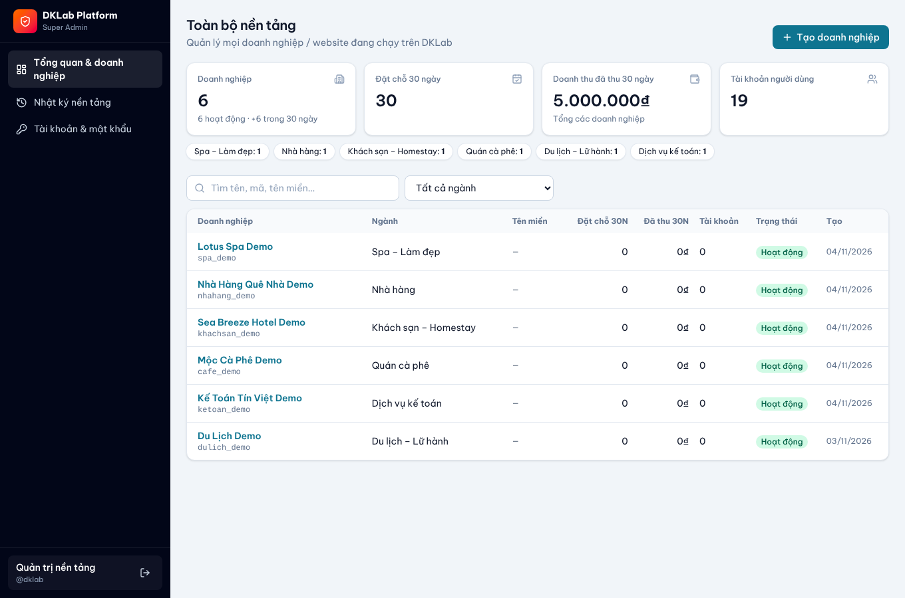 |

### Thêm ngành mới

```bash
npm run plugin:new -- salon "Salon tóc" slots     # hoặc: tables | rooms
npm run db:migrate                                 # tạo doanh nghiệp demo salon_demo
```

Lệnh trên tạo `src/plugins/salon/manifest.ts` (nhãn, màu, giờ mở cửa, module) và `seed.ts` (dữ liệu mẫu). Registry tự sinh (`src/plugins/_registry.ts`) khi chạy `dev` / `build`, **không sửa code core**. Ngành cần màn hình riêng (như kế toán) thì khai báo `modules` trong manifest, kèm quyền và menu riêng.

## Super Admin (`/superdklab`)

- Tài khoản **tách biệt hoàn toàn** với doanh nghiệp: khóa ký JWT, issuer, audience và cookie riêng, phiên 8 giờ. Đổi mật khẩu thì mọi phiên cũ bị thu hồi.
- **Tổng quan**: số doanh nghiệp, đặt chỗ, doanh thu 30 ngày, phân bố theo ngành; tìm và lọc doanh nghiệp.
- **Tạo doanh nghiệp** từ preset ngành: tự bật module, tạo vai trò mặc định, chi nhánh, tài khoản Chủ.
- **Khóa / mở khóa**: khóa thì website và mọi phiên đăng nhập bị chặn ngay. Đổi gói, **bật/tắt module**.
- **Tên miền**: xác minh thủ công hoặc thu hồi, gỡ.
- **Đặt lại mật khẩu** tài khoản của doanh nghiệp (đăng xuất mọi thiết bị).
- **Đăng nhập thay** để hỗ trợ khách:
  - Bắt buộc nhập lý do, phiên chỉ sống 1 giờ.
  - Trang admin hiện **banner cảnh báo**.
  - Ghi nhật ký ở cả nền tảng lẫn doanh nghiệp (mọi thao tác trong phiên có `impersonatedBy`).
- Nhật ký nền tảng: đăng nhập (cả thất bại), tạo / khóa, đăng nhập thay…
- Dữ liệu Super Admin **không lưu cache trên trình duyệt**.

### Module / core có sẵn

- **Hệ thống**: tenant, domain riêng, cài đặt thương hiệu, nhật ký thao tác (audit log)
- **Xác thực & phân quyền**: JWT, vai trò, ma trận quyền theo module, phạm vi `tenant`/`own`
- **Tiếp nhận đặt chỗ** (engine dùng chung cho tour, bàn, phòng, lịch spa): khách để lại họ tên và **SĐT (ưu tiên) hoặc email**, không cần tài khoản. Lễ tân thấy danh sách, bấm gọi / Zalo, chuyển trạng thái *Mới → Đã liên hệ → Xác nhận → Hoàn tất / Hủy*. **Chỉ khi xác nhận mới trừ chỗ** (khóa dòng, chống bán vượt).
- **Khách hàng (CRM)**: tự tạo / gộp theo SĐT, lịch sử đặt chỗ và hóa đơn, tag, ghi nhận đồng ý dữ liệu (NĐ 13/2023)
- **Nhân sự**: hồ sơ nhân viên, chức vụ, phòng ban, chi nhánh, lương cơ bản, liên kết tài khoản
- **Hóa đơn & thanh toán**: lập từ đặt chỗ, thuế GTGT theo dòng (0/5/8/10%, KCT, KKKNT), số tiền bằng chữ, in / PDF, **VietQR theo tài khoản ngân hàng chọn**, link thanh toán gửi khách, ghi nhận thu tiền nhiều lần
- **HĐĐT MISA**: đẩy hóa đơn sang MISA, phát hành, lưu ký hiệu / số / mã CQT
- **Du lịch – Tour**: tour, lịch trình, lịch khởi hành, số chỗ, giá người lớn / trẻ em / giá riêng từng ngày

## Bảo mật & JWT

**Xác thực**
- Access token: JWT HS256, sống 15 phút, gửi qua cookie `httpOnly; Secure; SameSite=Lax` (web) hoặc `Authorization: Bearer` (mobile/POS).
- Refresh token: chuỗi ngẫu nhiên 256-bit, DB chỉ lưu SHA-256, xoay vòng mỗi lần dùng, phát hiện token bị dùng lại.
- **Thu hồi tức thì**: mỗi request kiểm tra phiên còn hiệu lực, `tokenVersion`, trạng thái user và tenant (cache 15 giây). Đăng xuất, khóa tài khoản, đổi mật khẩu hay đổi quyền đều làm token cũ mất hiệu lực ngay.
- Mật khẩu argon2id. Rate limit đăng nhập theo IP (20 lần / 10 phút) và theo tài khoản + IP (8 lần / 15 phút), nên kẻ xấu ở IP khác không khóa được tài khoản của bạn. Ghi nhật ký cả đăng nhập thành công lẫn thất bại.

**Phân quyền & cách ly tenant**
- Quyền `module.resource.action[:own|branch|tenant]`, kiểm tra ở server.
- **Chống leo thang**: người không phải Chủ chỉ trao được quyền mình đang có; không ai ngoài Chủ sửa hoặc gán được vai trò Chủ.
- **Chống IDOR chéo tenant**: mọi ID nhận từ client (tour, lịch khởi hành, khách, user, chi nhánh) đều qua `assertOwned()`. Tham số `[id]` bắt buộc là UUID.
- Domain riêng phải **xác minh bằng DNS TXT** mới được định tuyến. Subdomain nền tảng chỉ định tuyến theo slug.

**Web**
- CSRF: kiểm tra `Origin` trong `proxy.ts`, bắt buộc `Content-Type: application/json`, giới hạn kích thước body.
- Header: CSP (`connect-src 'self'`, `frame-ancestors 'none'`), HSTS, X-Frame-Options, nosniff, Referrer-Policy, Permissions-Policy.
- MISA: chỉ gọi `https://*.meinvoice.vn`, không theo redirect (chống SSRF). Đổi nơi gửi hoặc tài khoản MISA phải nhập lại mật khẩu. Mật khẩu lưu AES-256-GCM.
- Form public: honeypot + rate limit theo IP và theo SĐT/email. Màu, URL ảnh được kiểm tra định dạng.
- `DEMO_MODE=1` mới hiện tài khoản demo và cho đổi tenant bằng `?tenant=`. Production từ chối chạy với `APP_SECRET` mẫu.

**Kiểm thử bảo mật**: `npm run test:security` chạy **44 kịch bản tấn công** thật qua HTTP:
- Chiếm domain, SSRF, IDOR chéo tenant (tour, bàn, lịch giữ chỗ, sơ đồ), leo quyền, CSRF.
- Thu hồi token, brute force, header bảo mật.
- Tách biệt Super Admin ↔ doanh nghiệp, đăng nhập thay, khóa doanh nghiệp.

Kết quả hiện tại: 44/44 bị chặn.

> Trên Vercel nên cấu hình `UPSTASH_REDIS_REST_URL` + `UPSTASH_REDIS_REST_TOKEN` (gói miễn phí) để rate limit đúng trên mọi instance.
> Tự host: đặt nginx/Caddy ghi đè header `X-Real-IP`.

## Giao diện website

- Design system: xanh trời `#0369a1` + cam `#EA580C` cho nút hành động, font Be Vietnam Pro.
- **3D & animation nhẹ, không thêm thư viện**:
  - Hero có 3 "bưu thiếp" tour trong không gian 3D (CSS perspective) lơ lửng và nghiêng theo chuột.
  - Thẻ tour nghiêng 3D + ánh sáng theo con trỏ; nội dung hiện dần khi cuộn; số liệu đếm động.
  - Thanh tiến trình đọc trang dùng CSS scroll-timeline.
  - Tất cả tắt khi bật *giảm chuyển động* (`prefers-reduced-motion`).
- **Hướng dẫn sử dụng** (`<Guide>`):
  - Có ở trang chủ, trang tour và trang Đặt chỗ của lễ tân.
  - Làm nổi bật từng phần, có Quay lại / Tiếp / Bỏ qua, phím ← → Esc. Tự mở ở lần ghé đầu, mở lại bằng nút "Hướng dẫn".
- **Gợi ý trường bắt buộc**:
  - Khung "Thông tin bắt buộc" có thanh tiến độ; ô bắt buộc có dấu `*`.
  - Lỗi hiện ngay dưới ô khi rời ô (`aria-describedby`). Gửi khi còn thiếu thì form rung nhẹ và con trỏ nhảy tới ô đầu tiên cần sửa. Dòng "Còn thiếu: …" ngay dưới nút gửi.
- Lọc tour theo số ngày / giá, tìm kiếm không dấu. Thanh "Đặt tour" cố định trên mobile.
- Bản landing page tham khảo dựng bằng 8B: https://mcp.8b.com/p/l61cosyrvo

## Tốc độ / cache

- **Admin**: RTK Query cache + `redux-persist` (localStorage).
  - Mở lại hoặc F5 thì hiển thị ngay từ cache (đã đo: ~180 ms, kể cả khi API không phản hồi), sau đó tự làm mới ngầm nếu dữ liệu cũ hơn 30 giây.
  - Thêm / sửa / xóa chỉ invalidate đúng nhóm dữ liệu liên quan. Danh sách đặt chỗ tự làm mới mỗi 30 giây.
  - Đăng xuất hoặc đổi người dùng thì xóa sạch cache.
- **Website public**: Server Components + `'use cache'` (Cache Components), cache theo tag `tours:<tenantId>`. Admin sửa tour hay xác nhận đặt chỗ thì `revalidateTag` ngay, nên số chỗ trống luôn đúng.
- Trang admin build thành HTML tĩnh. Trang public là Partial Prerender.

## Chạy local

```bash
cp .env.example .env.local      # sửa DATABASE_URL, APP_SECRET
npm install
npm run db:migrate              # tạo bảng + seed tenant dulich_demo
npm run dev
```

- Website: http://localhost:3000
- Quản trị: http://localhost:3000/admin
- Xem tenant khác trên domain chung: `?tenant=<slug>`

| Doanh nghiệp demo | Tài khoản (mật khẩu `Admin@123`) |
|---|---|
| Du lịch `dulich_demo` | admin@ / letan@ / ketoan@ / hdv@**dulichdemo.vn** |
| Spa `spa_demo` | admin@ / letan@ / ketoan@**spademo.vn** |
| Cà phê `cafe_demo` | admin@ / letan@ / ketoan@**cafedemo.vn** |
| Nhà hàng `nhahang_demo` | admin@ / letan@ / ketoan@**nhahangdemo.vn** |
| Khách sạn `khachsan_demo` | admin@ / letan@ / ketoan@**khachsandemo.vn** |
| Kế toán `ketoan_demo` | admin@ / letan@ / ketoan@**ketoandemo.vn** |

- Khi bật `DEMO_MODE=1`: xem website ngành khác bằng `/?tenant=spa_demo`. Trang `/login` có ô chọn doanh nghiệp demo.
- Super Admin: `/superdklab` → `dklab` / `Dklab@123`.

## Deploy Vercel (demo)

1. Import repo vào Vercel (Framework: Next.js).
2. **Storage → Neon Postgres** (Marketplace): `DATABASE_URL` được gán tự động.
3. Thêm biến môi trường:
   - `APP_SECRET`: chuỗi ngẫu nhiên ≥ 32 ký tự (`openssl rand -base64 48`)
   - `DEFAULT_TENANT=dulich_demo`
   - `ROOT_DOMAIN`: domain gốc của bạn, vd `dklab.vn`
   - `SEED_ADMIN_PASSWORD`: mật khẩu cho tài khoản demo
   - `DEMO_MODE=1` chỉ cho bản demo (không bật cho khách thật)
   - `PLATFORM_ADMIN_USER`, `PLATFORM_ADMIN_PASSWORD`: tài khoản Super Admin tạo lần đầu (đổi mật khẩu ngay)
   - (khuyến nghị) `UPSTASH_REDIS_REST_URL`, `UPSTASH_REDIS_REST_TOKEN`
4. Deploy. Lệnh `npm run build` tự chạy migrate + seed (idempotent) rồi `next build`.
5. Domain:
   - Truy cập `*.vercel.app` thì vào tenant mặc định.
   - Domain riêng của khách: thêm domain vào project Vercel → trỏ DNS theo hướng dẫn → khai báo trong **Admin → Cài đặt → Tên miền** → thêm bản ghi TXT được hiển thị → bấm **Xác minh**.
   - Subdomain kiểu `<khach>.dklab.vn`: thêm wildcard `*.dklab.vn` vào Vercel (cần dùng nameserver của Vercel).

## MISA meInvoice

- Mặc định chạy **chế độ giả lập (mock)** để demo toàn bộ luồng mà không cần tài khoản.
- Chạy thật: Admin → Cài đặt → Hóa đơn điện tử → chọn **MISA Test** hoặc **Production**, điền AppID (MISA cấp), MST, tài khoản, mật khẩu, ký hiệu hóa đơn → *Kiểm tra kết nối*.
- Luồng:
  1. Lấy token: `POST /api/integration/auth/token`
  2. Tạo hóa đơn: `POST /api/v3[/code]/itg/invoicepublishing/createinvoice`, nhận `TransactionID`
  3. Ký số
  4. Phát hành: `POST /api/v3[/code]/itg/invoicepublishing`
- Vercel không truy cập được USB token, nên bước ký số làm trên MISA meInvoice, hoặc dán XML đã ký (HSM / công cụ ký) để phát hành từ hệ thống.
- ⚠️ Đường dẫn API lấy theo tài liệu công khai tại doc.meinvoice.vn. **Cần chạy thử trên môi trường test của MISA với tài khoản thật** trước khi dùng production. Có ô *Base URL* để ghi đè nếu MISA cấp đường dẫn khác.

## Lộ trình tiếp theo

- Gọi món tại bàn bằng QR + màn hình bếp (KDS) cho cà phê / nhà hàng
- Gói liệu trình (spa), giá phòng theo mùa / cuối tuần (khách sạn)
- Thu phí doanh nghiệp theo gói (billing nền tảng), 2FA cho Super Admin
- Webhook ngân hàng (Casso / SePay) để tự đối soát chuyển khoản VietQR
- Gửi SMS / Zalo ZNS / email xác nhận; chấm công, ca làm, lương
